<p align="center">
  
</p>

# 🛡️ Awesome Fraud Detection & Prevention

<p align="center">
  <a href="https://github.com/ishandutta2007/Awesome-Awesome-Awesome"></a>
  <a href="https://discord.gg/jc4xtF58Ve"></a>
  <a href="https://awesome.re"></a>
  <a href="http://makeapullrequest.com"></a>
  <a href="https://github.com/ishandutta2007"></a>
</p>

> 🔍 A comprehensive, curated catalog of top-tier **SaaS fraud prevention platforms** and **open-source fraud detection engines**, spanning chargeback guarantees, transaction risk scoring, AML screening, behavioral biometrics, and machine learning fraud architectures.

---

## 📑 Table of Contents
- [🌐 Sector Overview & Market Dynamics](#-sector-overview--market-dynamics)
- [💼 SaaS & Hosted Platforms](#-saashosted-platforms)
- [💻 Open-Source GitHub Projects](#-open-source-github-projects)
  - [⚡ Transaction Monitoring & Decision Engines](#-transaction-monitoring--decision-engines)
  - [🧬 Machine Learning & Graph Fraud Frameworks](#-machine-learning--graph-fraud-frameworks)
  - [📱 Device Fingerprinting & Identity Intelligence](#-device-fingerprinting--identity-intelligence)
  - [📜 Sanctions, PEP & AML Compliance](#-sanctions-pep--aml-compliance)
  - [🛡️ Security & Abuse Frameworks](#-security--abuse-frameworks)
- [⚖️ Architectural Comparison: SaaS Network Effects vs. Open Source](#-architectural-comparison-saas-network-effects-vs-open-source)
- [🤝 How to Contribute](#-how-to-contribute)
- [💖 Support & Sponsorship](#-support--sponsorship)
- [📈 Star History](#-star-history)
- [⚠️ Disclaimer](#️-disclaimer)

---

## 🌐 Sector Overview & Market Dynamics

The global **Fraud Detection and Prevention (FDP)** market is valued at approximately **$35.7 billion to $42.4 billion in 2026** (projected to exceed $85 billion by the 2030s, compounding at ~15–19.6% CAGR). 

The market dynamics exhibit a dual structure: it is **moderately fragmented across specialized niches** (e.g., account takeover, bot mitigation, synthetic identities, behavioral biometrics), yet **heavily concentrated and winner-take-most at the enterprise transaction tier**, where global merchant network intelligence and collective transaction consortiums create an unassailable data moat against uncoordinated fraud rings.

---

## 💼 SaaS & Hosted Platforms

The table below lists industry-leading commercial platforms providing automated chargeback guarantees, real-time risk decisioning, and digital trust infrastructure. The entries are ranked in **descending order by company scale** (market capitalization / enterprise valuation or verified annual revenue).

| 🏢 Platform | 💰 Company Scale (Valuation / Revenue) | 🏷️ Pricing Model & Starting Tier | 🎁 Free Tier Limit / Free Trial Plan | 🔑 Core Differentiator |
| :--- | :--- | :--- | :--- | :--- |
| **[Shopify Fraud Analysis](https://help.shopify.com/en/manual/orders/fraud-analysis)** | **~$100B+ Market Cap** (Shopify Inc. NYSE: SHOP) / $7B+ ARR | Built into Shopify store plans; starting at **$39/month** (Basic Plan, or $29/mo billed annually) + 2.9% + 30¢ payment processing | **3-day free trial** (frequently promotional $1/month for first 3 months) across full store builder & fraud analysis suite | Native e-commerce integration flagging proxy usage, AVS/CVV mismatches, and multiple payment attempts directly in admin. |
| **[Forter](https://www.forter.com/)** | **$3.0 Billion Valuation** (Series F) / ~$200M ARR | Outcome-based enterprise pricing starting around **0.30%–0.60% of GMV approved** (or custom per-transaction rates; annual contract) | **No free tier**; 30-day customized historical shadow data trial / ROI scoping pilot via sales | 1.8B+ known global identity network delivering instant sub-second approvals with 100% financial chargeback guarantees. |
| **[Signifyd](https://www.signifyd.com/)** | **$1.34 Billion Valuation** (Series E unicorn) / ~$250M ARR | Guaranteed model based on GMV; baseline contracts start at **~$1,000–$4,500/year** (typically ~0.5%–1.2% per approved order) | **No open free tier**; 14-day staging sandbox evaluation & proof-of-concept pilot with risk-free historical data replay | Full financial guarantee on approved transactions, pioneering Agentic Commerce protection for autonomous AI shoppers. |
| **[Riskified](https://www.riskified.com/)** | **$1.15 Billion Market Cap** (NYSE: RSKD) / ~$400M–$410M (2026E Revenue) | Performance-based pricing starting from **0.40%–1.0% of approved order volume** (billed only on successfully cleared sales) | **No open free tier**; 30-day proof-of-concept pilot analyzing pre-cleared offline batch logs | Global merchant network analyzing over 1B transactions with Smart Linking graph clustering and automated chargeback liability shift. |
| **[Sift](https://sift.com/)** | **$1.0 Billion Valuation** (Unicorn) / ~$150M+ ARR | Pay-per-event pricing starting at **$500/month** (scaling with billable events: logins, payments, content submissions) | **No permanent free tier**; 14-day sandbox API evaluation trial with full access to test events and ML scoring | Ensemble ML models decisioning transactions under 150ms, featuring specialized AI Agents and Model Context Protocol (MCP) servers. |
| **[Kount](https://www.kount.com/)** | **$640 Million Valuation** (Acquired by Equifax) / ~$65M+ ARR | Scaled per-event pricing starting at **~$1,000/year** (or ~$0.05–$0.15 per transaction query on baseline tiers) | **No permanent free tier**; 30-day guided evaluation pilot with simulated historical risk scoring | Identity Trust Global Network leveraging Equifax credit and identity telemetry with multi-layered Omniscore AI analysis. |
| **[SEON](https://seon.io/)** | **~$400 Million Valuation** (Series B, IVP) / ~$30M+ ARR | Transparent SaaS tier starting at **$699/month** (Starter tier for up to 2,500 API calls/month; $0.28 per extra call) | **14-day free trial** with access to live API sandbox, Chrome extension, and up to 100 free manual lookup checks | 900+ real-time social & digital footprint data enrichment signals based strictly on email, phone number, and IP lookup. |
| **[ClearSale](https://www.clear.sale/)** | **~$350 Million Market Cap** (B3: CLSA3) / ~$100M+ ARR | Hybrid contingency pricing starting at **1.25%–2.0% per approved order** (or standard fixed API scoring ~0.10/order) | **No permanent free tier**; 30-day operational audit trial reviewing historical transaction files | Proprietary blend of advanced statistical algorithms backed by 24/7 specialized human review analysts for zero false positives. |
| **[NoFraud](https://www.nofraud.com/)** | **~$120 Million Valuation** (Series A/B) / ~$15M+ ARR | Transaction fee starting at **~0.40%–0.50% per approved transaction** (no setup fees, no monthly software retainer) | **14-day free trial** (risk-free screening/pilot mode on Shopify, BigCommerce, and WooCommerce stores) | Frictionless chargeback indemnification with automated real-time phone/SMS customer verification workflows. |
| **[FraudLabs Pro](https://www.fraudlabspro.com/)** | **~$10 Million Valuation** (Bootstrapped / Hexasoft) / ~$3M ARR | Tiered plans starting at **$29.95/month** (Mini: 1,500 queries) up to $1,249.95/month (Enterprise: 500,000 queries) | **Free Micro Plan forever**: **500 queries/month**, up to $25k monthly sales volume, 5 custom rules, and 10 free SMS credits | Developer-first REST fraud scoring API with turn-key extensions for Magento, WooCommerce, OpenCart, and PrestaShop. |

---

## 💻 Open-Source GitHub Projects

The following self-hosted engines, machine learning frameworks, and compliance databases allow engineering teams to build custom fraud infrastructure. Entries are ranked in **descending order by GitHub stargazers count** [](https://github.com/ishandutta2007/Awesome-Fraud-Detection-Prevention/stargazers).

| 📦 Repository & Link | ⭐ Stars_Count | 💻 Primary Stack | 📜 License | 🎯 Functional Focus |
| :--- | :--- | :--- | :--- | :--- |
| **[fingerprintjs/fingerprintjs](https://github.com/fingerprintjs/fingerprintjs)** | [](https://github.com/fingerprintjs/fingerprintjs/stargazers) | TypeScript / JS | BSL / Apache | Client-side browser identification, canvas/audio fingerprinting, and bot detection without cookies. |
| **[ballerine-io/ballerine](https://github.com/ballerine-io/ballerine)** | [](https://github.com/ballerine-io/ballerine/stargazers) | TypeScript / Node.js | Apache-2.0 | Open-source infrastructure and workflow orchestration for identity verification, KYB/KYC, and risk decisioning. |
| **[wfh45678/radar](https://github.com/wfh45678/radar)** | [](https://github.com/wfh45678/radar/stargazers) | Java / Vue | Apache-2.0 | High-throughput distributed real-time risk control engine with dynamic rule scripting and risk model evaluation. |
| **[safe-graph/DGFraud](https://github.com/safe-graph/DGFraud)** | [](https://github.com/safe-graph/DGFraud/stargazers) | Python / PyTorch / DGL | MIT | Deep Graph-based Fraud Detection toolbox implementing cutting-edge GNN algorithms (GAS, SemiGNN, GraphConsis). |
| **[Fraud-Detection-Handbook/fraud-detection-handbook](https://github.com/Fraud-Detection-Handbook/fraud-detection-handbook)** | [](https://github.com/Fraud-Detection-Handbook/fraud-detection-handbook/stargazers) | Python / Jupyter | MIT | Comprehensive reproducible handbook, benchmarks, and production-grade architectures for credit card fraud ML. |
| **[checkmarble/marble](https://github.com/checkmarble/marble)** | [](https://github.com/checkmarble/marble/stargazers) | Go / React / Postgres | Open Core | Real-time transaction monitoring, AML decision engine, adverse media screening, and unified fraud investigator case manager. |
| **[moov-io/watchman](https://github.com/moov-io/watchman)** | [](https://github.com/moov-io/watchman/stargazers) | Go / Docker | Apache-2.0 | Lightweight, standalone sanctions list screening microservice using Jaro-Winkler distance against OFAC/SDN lists. |
| **[opensanctions/yente](https://github.com/opensanctions/yente)** | [](https://github.com/opensanctions/yente/stargazers) | Python / ElasticSearch | MIT | Fast self-hosted screening API for sanctions, politically exposed persons (PEPs), and persons of interest databases. |
| **[jube-home/aml-fraud-transaction-monitoring](https://github.com/jube-home/aml-fraud-transaction-monitoring)** | [](https://github.com/jube-home/aml-fraud-transaction-monitoring/stargazers) | C# / .NET | AGPL-3.0 | Real-time AML transaction monitoring platform integrating rule engines with supervised/unsupervised adaptive neural networks. |
| **[FraudGuard/FraudGuard](https://github.com/FraudGuard/FraudGuard)** | [](https://github.com/FraudGuard/FraudGuard/stargazers) | Python / Shell | AGPL-3.0 | Threat intelligence and abuse monitoring security framework for detecting suspicious IPs and registration spam. |

---

### ⚡ Transaction Monitoring & Decision Engines
* **[checkmarble/marble](https://github.com/checkmarble/marble)** [](https://github.com/checkmarble/marble/stargazers) — Modern, full-featured fraud & AML decision engine written in Go. Operates as an open-core alternative to SEON and Feedzai, supporting real-time transaction scoring, custom SQL/JSON data models, and audit trails.
* **[wfh45678/radar](https://github.com/wfh45678/radar)** [](https://github.com/wfh45678/radar/stargazers) — Ultra-fast distributed rule management and execution system designed for financial risk control, supporting hot-reloading Groovy rules and complex event processing.
* **[jube-home/aml-fraud-transaction-monitoring](https://github.com/jube-home/aml-fraud-transaction-monitoring)** [](https://github.com/jube-home/aml-fraud-transaction-monitoring/stargazers) — Adaptive machine learning transaction monitoring platform built on .NET, pairing heuristic rule engines with neural network topology search.

### 🧬 Machine Learning & Graph Fraud Frameworks
* **[safe-graph/DGFraud](https://github.com/safe-graph/DGFraud)** [](https://github.com/safe-graph/DGFraud/stargazers) — Graph neural network (GNN) framework tailored for detecting fraud rings, card clusters, and collateral rings across heterogeneous graph databases.
* **[Fraud-Detection-Handbook/fraud-detection-handbook](https://github.com/Fraud-Detection-Handbook/fraud-detection-handbook)** [](https://github.com/Fraud-Detection-Handbook/fraud-detection-handbook/stargazers) — The gold standard academic and engineering reference for credit card fraud detection with real-time imbalanced classification and cost-sensitive evaluation models.

### 📱 Device Fingerprinting & Identity Intelligence
* **[fingerprintjs/fingerprintjs](https://github.com/fingerprintjs/fingerprintjs)** [](https://github.com/fingerprintjs/fingerprintjs/stargazers) — High-accuracy browser fingerprinting library that extracts 30+ device attributes (WebGL, canvas, audio, fonts) to identify returning bots and fraudulent users.
* **[ballerine-io/ballerine](https://github.com/ballerine-io/ballerine)** [](https://github.com/ballerine-io/ballerine/stargazers) — Enterprise-grade risk and identity orchestration layer that unifies KYC, KYB, and fraud detection into modular, customizable workflow graphs.

### 📜 Sanctions, PEP & AML Compliance
* **[moov-io/watchman](https://github.com/moov-io/watchman)** [](https://github.com/moov-io/watchman/stargazers) — High-speed, self-contained sanctions screening engine written in Go. Regularly updates and fuzzy-matches against US Treasury OFAC (SDN, SSI), BIS, and international embargo lists.
* **[opensanctions/yente](https://github.com/opensanctions/yente)** [](https://github.com/opensanctions/yente/stargazers) — Turn-key Dockerized screening search engine indexing global Politically Exposed Persons (PEPs), sanctions, and crime databases.

### 🛡️ Security & Abuse Frameworks
* **[FraudGuard/FraudGuard](https://github.com/FraudGuard/FraudGuard)** [](https://github.com/FraudGuard/FraudGuard/stargazers) — Threat detection framework designed to collect telemetry, prevent credential stuffing, and score account creation abuse.

---

## ⚖️ Architectural Comparison: SaaS Network Effects vs. Open Source

```
+--------------------------------------------------------------------------------------------------+
|                                    COMMERCIAL SAAS MOAT                                          |
|  • Cross-Merchant Identity Graph (Billions of records across thousands of retailers)             |
|  • Zero-Liability Chargeback Insurance (Merchant pays % GMV; Vendor absorbs dispute costs)       |
|  • Turn-Key Compliance (PCI-DSS Level 1, SOC 2 Type II, automated SAR filing)                  |
+--------------------------------------------------------------------------------------------------+
                                                 VS
+--------------------------------------------------------------------------------------------------+
|                                  OPEN-SOURCE SELF-HOSTED STACK                                   |
|  • Complete Data Privacy (Sensitive PII never leaves VPC / on-prem infrastructure)               |
|  • Zero Margin Markup (No 0.5%–1.5% GMV fee overhead on high-margin products)                   |
|  • Full Deterministic Rule Control (Tailored domain heuristic logic & custom GNN pipelines)      |
+--------------------------------------------------------------------------------------------------+
```

1. **The Consortium Moat**: Commercial giants like Signifyd, Riskified, and Forter win by pooling consumer signals across thousands of retailers. An identity committing fraud on Merchant A is instantly banned on Merchant B before attempting a checkout. A self-hosted tool has zero visibility beyond its own perimeter.
2. **When to Choose Open Source**: Use open-source projects like **Marble**, **Radar**, **Ballerine**, and **DGFraud** when you operate high-margin digital products, have strict data sovereignty obligations prohibiting PII transmission to 3rd-party vendors, or already possess in-house machine learning talent capable of training custom fraud classifiers.

---

## 🤝 How to Contribute

Contributions are warmly welcomed! Please follow these steps to keep the list high quality:

1. 🍴 Fork the repository.
2. 🌿 Create a descriptive feature branch (`git checkout -b feat/add-new-fraud-tool`).
3. 📝 Update `README.md` maintaining consistent markdown formatting, star links, and factual pricing/scale specifications.
4. 🚀 Submit a Pull Request with a short summary of the project's utility and license.

---

## 💖 Support & Sponsorship

Thank you so much for exploring and using this project! If you found this curated ecosystem helpful in designing your payment protection or fraud detection architecture, please consider showing your support:

* ⭐ **Star the repository** to boost discoverability for other developers and fraud teams.
* 🍴 **Fork and share** the project with your colleagues and network.
* ☕ **Buy me a coffee / Sponsor the author**: Support continuous updates and new curated ecosystems by visiting the [GitHub Sponsors Dashboard](https://github.com/sponsors/ishandutta2007).

Your backing and encouragement are deeply appreciated!

---

##  Star History
[](https://star-history.dera.page/#ishandutta2007/Awesome-Fraud-Detection-Prevention&type=date&legend=top-left)

---

## ⚠️ Disclaimer

* This repository is a community-curated list maintained for educational and architectural reference only.
* Transaction fraud detection systems require strict compliance with PCI-DSS, GDPR, and consumer protection mandates. False positive decline rates directly reduce top-line conversion, while false negative allowances increase chargeback ratios. Validate all risk thresholds carefully.

---

<p align="center">
  <sub>Built with ❤️ for merchants, fintech engineers, fraud operations teams, and risk analysts worldwide.</sub>
</p>
